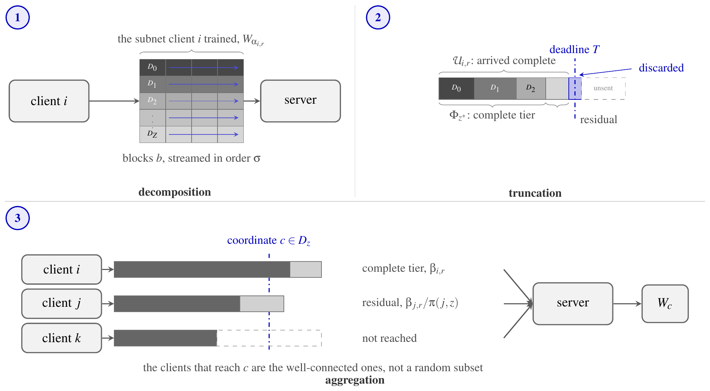
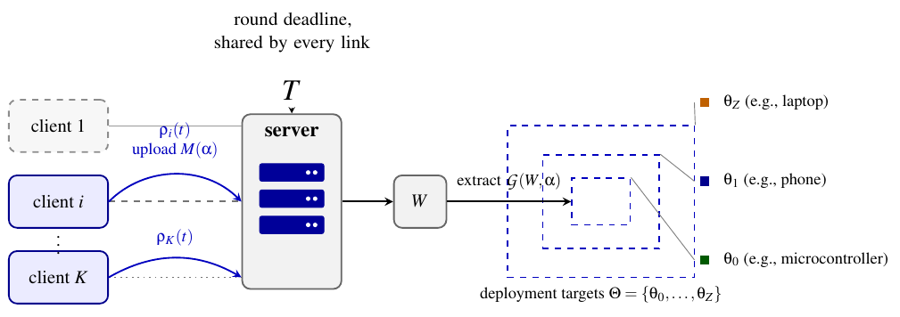
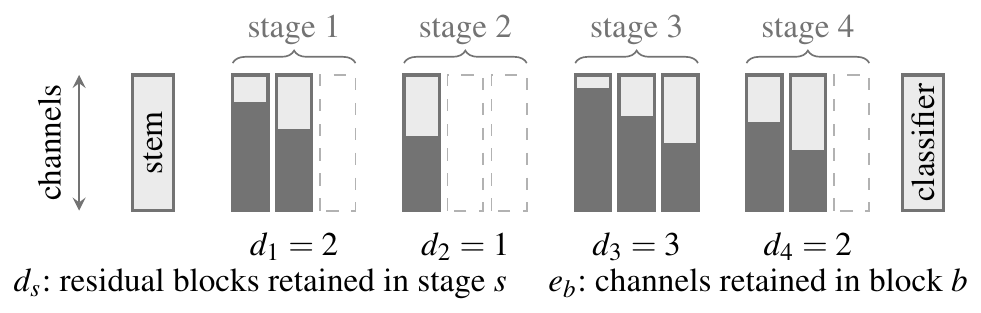
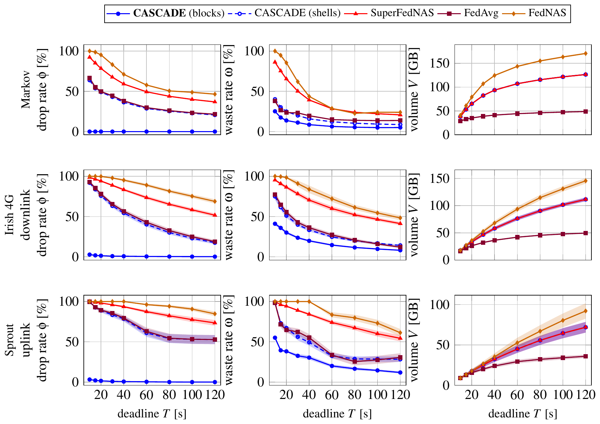
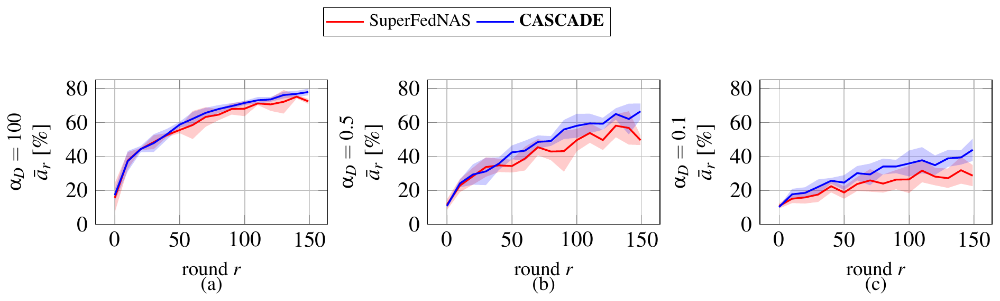
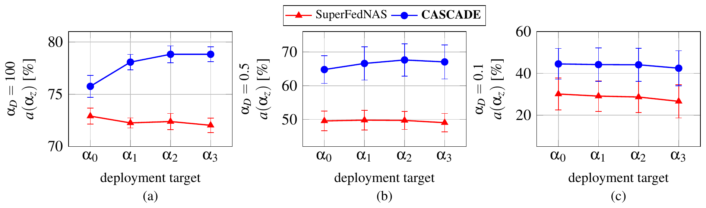
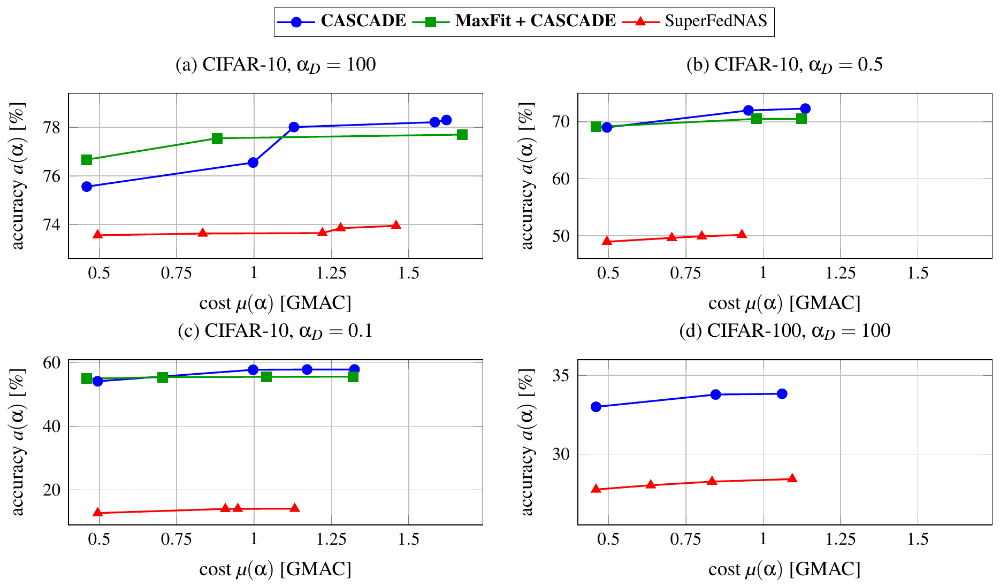
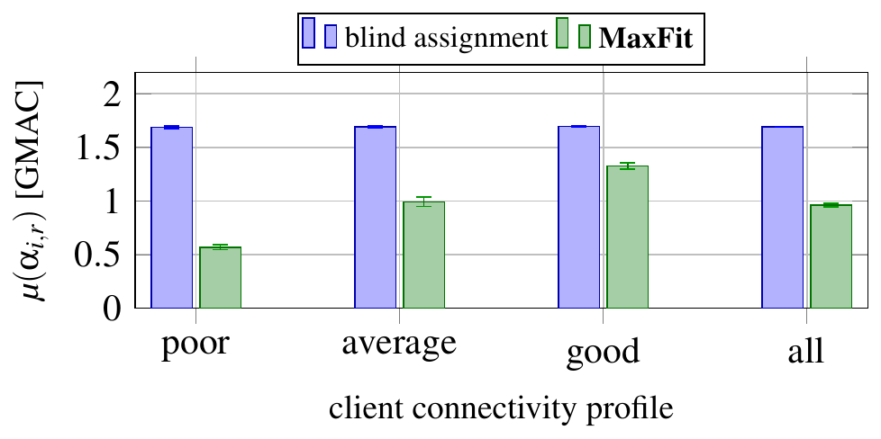

# CASCADE: Communication-Aware Supernet Chunking with Anytime Delivery

**Federated neural architecture search under dynamic bandwidth** (code name: dynFedNAS)

[](LICENSE)


Research code for **"CASCADE: Anytime Supernet Delivery for Federated Neural Architecture Search
under Dynamic Bandwidth"** by Rafael Bragança Oliveira, written at the Distributed Computing Group
(DISCO), ETH Zürich, under the supervision of Prof. Roger Wattenhofer and Dr. Antonio Di Maio.

The repository is a fork of [SuperFedNAS](https://github.com/gatech-sysml/superfednas) (ECCV 2024),
which is built on [FedML](https://github.com/FedML-AI/FedML). It adds a deadline-bound communication
simulator, a nested "anytime" upload mechanism with a matching aggregation rule (**CASCADE**), a
capacity-aware subnet assignment policy (**MaxFit**), and the scripts and data behind the paper's
figures. Code inherited from SuperFedNAS keeps its original behavior. See
[What is new and what is inherited](#what-is-new-and-what-is-inherited).

<p align="center">
  
</p>

## Contents

1. [Motivation](#motivation)
2. [Method](#method)
3. [Results](#results)
4. [What is new and what is inherited](#what-is-new-and-what-is-inherited)
5. [Repository layout](#repository-layout)
6. [Installation](#installation)
7. [Quick start](#quick-start)
8. [Reproducing the experiments](#reproducing-the-experiments)
9. [Data and results in this repository](#data-and-results-in-this-repository)
10. [Tests](#tests)
11. [Known limitations](#known-limitations)
12. [Citation](#citation)
13. [License and acknowledgements](#license-and-acknowledgements)

## Motivation

Federated learning (FL) trains a shared model across many devices without moving their data. No
single architecture fits every device, so **federated neural architecture search (FedNAS)** trains a
family of architectures at once. SuperFedNAS does this with a *supernet*: one set of weights from
which many smaller subnets can be extracted, so a single training run serves every deployment
target.

Existing FedNAS methods assume that a client's uplink stays fixed for the whole run. In practice it
fluctuates from round to round. Under a synchronous round deadline this has a harsh consequence: a
client whose upload does not finish in time is dropped entirely, and its work is wasted. The dropped
clients are not random. They are the ones with the weakest links, so under non-IID data whole slices
of the label distribution can silently disappear from training.

This work asks two questions.

1. How can a supernet update be transmitted so that a deadline-bound round still yields a usable
   contribution from every selected client, without estimating anyone's uplink capacity?
2. Can round-by-round awareness of each client's link reduce the computation spent on updates that
   are never delivered?

## Method

The system has K clients, each with a private, non-IID data partition and an uplink whose capacity
changes over time. Every round has one deadline T, shared by all links. The server holds one
supernet and must serve several deployment targets, from a microcontroller to a laptop.

<p align="center">
  
</p>

The supernet is a ResNet whose subnets keep a prefix of each stage's residual blocks (depth, `d`) and
a prefix of each block's channels (width, `e`). A smaller subnet therefore only ever removes content
from a larger one. This nesting is what CASCADE turns into a transmission order.

<p align="center">
  
</p>

- **Shells and blocks.** An update is decomposed along two axes: *shells* (parameters grouped by the
  smallest tier that needs them) and *blocks* (the backbone's structural units). A shell crossed with
  a block is the unit that a client transmits and that the server accounts for. Units are sent shell
  by shell, so every prefix that the deadline admits is itself a valid update of a smaller subnet.
  The deadline alone decides how much each client contributes. No bandwidth estimate is needed.
- **Region-specific aggregation.** Partial delivery makes some regions of the supernet reachable only
  by well-connected clients, which biases a plain coordinate-wise average. CASCADE weights each
  delivered unit by the inverse of the long-run frequency with which that client reaches that
  region, with a cap for stability.
- **MaxFit.** An assignment policy that gives each client the largest subnet that its estimated link
  can carry, where the estimate comes from the previous round. No client trains or transmits content
  that the deadline would discard. It reduces wasted computation and bytes.

The thesis contains the derivations, the proof that shell-major order maximizes the deepest
deployable subnet delivered, and the full experimental protocol.

### How the paper's terms map to the code

| Concept in the paper | Where it lives |
| --- | --- |
| Round deadline and bandwidth simulation | `--comm_sim --bw_deadline T`, [`comm_sim/comm_simulator.py`](fedml_api/standalone/superfednas/comm_sim/comm_simulator.py) |
| Baseline: whole update or nothing (SuperFedNAS) | `--tx_mode all_or_nothing` with `--subnet_dist_type TS_all_random` |
| Nested shells (anytime delivery) | `--tx_mode nested`, [`comm_sim/transmission.py`](fedml_api/standalone/superfednas/comm_sim/transmission.py) |
| Shell × block stream (CASCADE) | `--tx_mode nested_blocks`, [`comm_sim/transmission.py`](fedml_api/standalone/superfednas/comm_sim/transmission.py), [`comm_sim/sharding.py`](fedml_api/standalone/superfednas/comm_sim/sharding.py) |
| Region-specific aggregation rule | `--aggregation_rule cascade`, [`comm_sim/aggregation.py`](fedml_api/standalone/superfednas/comm_sim/aggregation.py) (`inverse_frequency_correction`) |
| MaxFit | `--subnet_dist_type capacity_aware --bw_estimate lagged`, [`Server/ServerModel/base_server_model.py`](fedml_api/standalone/superfednas/Server/ServerModel/base_server_model.py) |
| Synthetic Markov channel | [`comm_sim/bandwidth.py`](fedml_api/standalone/superfednas/comm_sim/bandwidth.py) (`MarkovBandwidth`, `--bw_profile tiered_continuous`) |
| Measured channels (Irish 4G LTE, Sprout) | `TraceReplayBandwidth` in [`comm_sim/bandwidth.py`](fedml_api/standalone/superfednas/comm_sim/bandwidth.py), [`comm_sim/traces.py`](fedml_api/standalone/superfednas/comm_sim/traces.py) |
| FedAvg and FedNAS under the same deadline | [`cluster/run_fedavg_commsim.sbatch`](cluster/run_fedavg_commsim.sbatch), [`cluster/run_fednas_commsim.sbatch`](cluster/run_fednas_commsim.sbatch) |
| Pareto-front search on a trained supernet | [`fedml_experiments/standalone/superfednas/search_phase.py`](fedml_experiments/standalone/superfednas/search_phase.py) |

## Results

The setting is 20 clients with 8 participating per round, 150 rounds, a 20 s deadline, and a
Dirichlet label partition with concentration α<sub>D</sub> ∈ {100, 0.5, 0.1} (lower is more
non-IID). Datasets are CIFAR-10 and CIFAR-100. The supernet is a ResNet-based once-for-all network
(`ofaresnet50_32x32_10_26`). Four reference architectures form the deployment ladder, from 0.46 to
3.40 GMACs (41.6 MB to 286.9 MB of parameters). The baselines are SuperFedNAS with all-or-nothing
delivery, FedAvg, and FedNAS. The thesis reports the confidence intervals and the caveats.

| Measure | Result |
| --- | --- |
| Clients that lose their entire update in a round | 77–98% with all-or-nothing delivery, under 1% with CASCADE |
| Accuracy at every deployment target, CIFAR-10 | +5.5 to +17.0 points over SuperFedNAS (three, six and eight seeds at α<sub>D</sub> = 100, 0.5, 0.1) |
| Accuracy at every deployment target, CIFAR-100 | about +6 points |
| MaxFit on top of CASCADE | about 22% fewer bytes and 43% less computation at the same accuracy |

### Delivery under a deadline

<p align="center">
  
</p>

Drop rate φ, waste rate ω and transmitted volume V against the round deadline, on a synthetic Markov
channel and on two measured channels (Irish 4G LTE downlink, Sprout uplink). Lines are means over 20
channel seeds, and bands are 95% confidence intervals. CASCADE (blue) keeps the drop rate near zero
at every deadline.

### Accuracy over training

<p align="center">
  
</p>

Target-averaged accuracy of CASCADE and SuperFedNAS's all-or-nothing delivery over the full run, at
three non-IID degrees. Lines are means over seeds, and bands are 95% confidence intervals of the
mean.

### Accuracy across the deployment ladder

<p align="center">
  
</p>

Accuracy at each of the four reference architectures. A rising line has the ordering that a ladder
is meant to have. A flat or falling line has lost it. Bars are the standard deviation over seeds.

### Cost and accuracy

<p align="center">
  
</p>

Accuracy against inference cost for the architectures that the evolutionary search returns and that
no cheaper architecture beats. Both axes increase by construction. This is a single seed.

### MaxFit

<p align="center">
  
</p>

Local training cost per client-round under blind assignment and under MaxFit, by connectivity
profile. MaxFit composes with CASCADE on the assignment layer. Its result is not a further accuracy
gain: it holds accuracy for fewer bytes and less computation, and it saves the most on poorly
connected clients.

All figures are taken from the paper. The numbers behind them are in
[`analysis/csv/`](analysis/csv) and [`results/pareto/`](results/pareto).

## What is new and what is inherited

The first commit of this repository (`eb8ef11`) is the SuperFedNAS-derived snapshot. Everything
after it is new work. To list what changed:

```bash
git diff --stat eb8ef11 HEAD
```

| Added by this work | Path |
| --- | --- |
| Deadline-bound communication simulator, bandwidth models, trace replay | `fedml_api/standalone/superfednas/comm_sim/` |
| Transmission plans, nested shell and block streams, sharding | `comm_sim/transmission.py`, `comm_sim/sharding.py` |
| Aggregation rules under partial delivery | `comm_sim/aggregation.py` |
| Subnet assignment (MaxFit and successors) and client selection | `Server/ServerModel/base_server_model.py`, `comm_sim/policies/` |
| Pure-Python self-tests for all of the above | `comm_sim/selftest_*.py`, `comm_sim/verify_nesting.py` |
| Search phase on a trained supernet | `fedml_experiments/standalone/superfednas/search_phase.py` |
| SLURM runners for every experiment | `cluster/` |
| Offline delivery sweeps, trace archives, log parsing | `analysis/` |
| Hooks into the trainer, CLI flags, baselines under a deadline | edits to `superfednas_trainer.py`, `parse_args.py`, `train.py`, and the FedAvg and FedNAS entry points |

Inherited from SuperFedNAS and FedML, unchanged in purpose: the FL framework (`fedml_core/`,
`fedml_api/`), the elastic ResNet and MobileNet supernets (`elastic_nn/`), MaxNet training, the
evolutionary search (`nas/`), and the plots in `pareto_plotting/` and `figures/`.

The `comm_sim/policies/` package (greedy, Lyapunov and contextual-bandit assignment, plus
client-selection probes) is exploratory code written along the way. It is not part of the results
reported above.

## Repository layout

```
.
├── fedml_api/
│   ├── standalone/superfednas/
│   │   ├── Client/             client-side training (subnet, supernet, multinet trainers)
│   │   ├── Server/             supernet, server models, aggregation and the round loop
│   │   ├── elastic_nn/         elastic ResNet, MobileNet, TCN and DARTS supernets
│   │   ├── comm_sim/           deadline simulator, channels, CASCADE, MaxFit helpers, self-tests
│   │   └── learning_rate_schedule/
│   ├── standalone/fedavg/      FedAvg (also a baseline under a deadline)
│   ├── distributed/fednas/     FedNAS-DARTS (baseline)
│   └── data_preprocessing/     dataset loaders and non-IID partitioning
├── fedml_core/                 FedML communication and distributed primitives
├── fedml_experiments/standalone/superfednas/
│   ├── train.py                entry point for training
│   ├── parse_args.py           every flag, with help text
│   └── search_phase.py         search on a trained supernet
├── cluster/                    SLURM scripts and environment setup
├── analysis/                   offline sweeps, trace archives, log parsing, result CSVs
├── results/pareto/             Pareto-search outputs
├── docs/figures/               figures from the paper
├── nas/                        SuperFedNAS evolutionary search (inherited)
├── pareto_plotting/, figures/  plots and notebooks from SuperFedNAS (inherited)
├── requirements-modern.txt     installable dependency set
├── requirements.txt, eccv_2024.yml   original pinned environment (see Installation)
└── LICENSE, NOTICE, CITATION.cff
```

## Installation

Training needs a CUDA GPU. The self-tests and the offline sweeps need only NumPy.

```bash
python3 -m venv .venv && source .venv/bin/activate

# 1. PyTorch matching your CUDA version: https://pytorch.org
pip install torch torchvision

# 2. The public once-for-all package, without its (very old) dependencies
pip install --no-deps ofa==0.1.0.post202012082159

# 3. Everything else
pip install numpy scipy matplotlib tqdm scikit-learn networkx PyYAML Pillow h5py wandb
```

`ofa` 0.1.0 predates the removal of `torch._six`. `train.py` and `search_phase.py` install a small
compatibility shim before they import it, so no manual patching is needed.

`requirements.txt` and `eccv_2024.yml` describe the original SuperFedNAS environment (PyTorch 1.4,
TensorFlow 1.14). They are kept for reference and do not install on current hardware.
[`requirements-modern.txt`](requirements-modern.txt) is the loosened set, and the commands above are
its equivalent in installation order. [`cluster/setup_env.sh`](cluster/setup_env.sh) shows the same
steps for a SLURM cluster, including a check that every OFA import resolves.

### Data

CIFAR-10 and CIFAR-100 are fetched by torchvision on first use into the directory given by
`--data_dir`. If the default mirror is slow, [`download_cifar10.py`](download_cifar10.py) downloads
CIFAR-10 from an alternative mirror in the layout that torchvision expects. Non-IID client
partitions are drawn in code from a Dirichlet distribution (`--partition_method hetero
--partition_alpha α`).

### Experiment logging

Runs log to [Weights & Biases](https://wandb.ai). To disable logging, set `WANDB_MODE=offline`. Pass
your own project and entity with `--wandb_project_name` and `--wandb_entity`.

## Quick start

All training commands run from `fedml_experiments/standalone/superfednas/`.

**Check the installation without a GPU** (a few seconds, NumPy only), from the repository root:

```bash
python3 -m fedml_api.standalone.superfednas.comm_sim.selftest_aggregation
```

**Common arguments** for the configuration used in the paper (20 clients, 8 per round, a four-tier
ladder, MaxNet weighting with cosine decay):

```bash
COMMON="--gpu 0 --dataset cifar10 --data_dir ./../../../data/cifar10 \
  --model ofaresnet50_32x32_10_26 --partition_method hetero --partition_alpha 100 \
  --client_num_in_total 20 --client_num_per_round 8 --comm_round 150 \
  --epochs 5 --batch_size 64 --client_optimizer sgd --lr 0.1 --ci 0 --init_seed 0 \
  --diverse_subnets {\"0\":{\"d\":[0,0,0,0],\"e\":0.1},\"1\":{\"d\":[0,1,0,1],\"e\":0.14},\"2\":{\"d\":[1,1,1,1],\"e\":0.18},\"3\":{\"d\":[2,2,2,2],\"e\":0.25}} \
  --weighted_avg_schedule {\"type\":\"maxnet_cos_all_subnet\",\"num_steps\":120,\"init\":0.9,\"final\":0.125} \
  --frequency_of_the_test 25 --efficient_test --verbose"

CHANNEL="--comm_sim --bw_deadline 20 --bw_seed 0 --bw_profile tiered_continuous \
  --bw_jitter_sigma 0.45 --bw_estimate lagged"
```

**Baseline: SuperFedNAS under the round deadline** (whole update or nothing):

```bash
python train.py $COMMON $CHANNEL --subnet_dist_type TS_all_random --tx_mode all_or_nothing \
  --wandb_project_name dynfednas --wandb_run_name baseline
```

**CASCADE** (shell × block stream with the region-specific aggregation rule):

```bash
python train.py $COMMON $CHANNEL --subnet_dist_type TS_all_random --tx_mode nested_blocks \
  --maxnet_delivery_aware --aggregation_rule cascade \
  --wandb_project_name dynfednas --wandb_run_name cascade
```

**CASCADE with MaxFit**:

```bash
python train.py $COMMON $CHANNEL --subnet_dist_type capacity_aware --tx_mode nested_blocks \
  --maxnet_delivery_aware --aggregation_rule cascade \
  --wandb_project_name dynfednas --wandb_run_name cascade_maxfit
```

The commands above are assembled from the flags and defaults used by the scripts in `cluster/`, and
[`parse_args.py`](fedml_experiments/standalone/superfednas/parse_args.py) documents every flag. Run
a short smoke test first (`--comm_round 3`) and check that the training loss falls.

## Reproducing the experiments

### Training runs

[`cluster/`](cluster) holds the SLURM scripts used for every run. The ones to start from:

| Script | Purpose |
| --- | --- |
| `run_selection_probe.sbatch` | Main runner. Positional arguments cover transmission mode, aggregation rule, sampler, dataset, deadline, α<sub>D</sub>, seed, and extra flags. |
| `run_v2_arm.sbatch` | One arm of the transmission-mode comparison. |
| `run_parallel_arms.sbatch` | Up to four arms concurrently in one job, one per GPU. |
| `run_fedavg_commsim.sbatch`, `run_fednas_commsim.sbatch` | FedAvg and FedNAS baselines under the same deadline. |
| `run_search_pareto.sbatch` | Pareto-front search on a trained supernet (wraps `search_phase.py`). |
| `run_analysis_cpu.sbatch` | CPU-only analysis, such as the deadline sweep. |

The scripts were written for the ETH D-INFK student cluster. Adjust `--account`, the CUDA module, the
virtual-environment path, and the W&B entity for your own site. A seed sets both the weight
initialization and the bandwidth chain, so arms compared under one seed share a channel. cuDNN
determinism is off, so two runs with the same seed still differ slightly. Compare methods over
several seeds.

### Search phase

After training, `search_phase.py` loads a supernet checkpoint and evaluates the four tier
architectures, a random population from the full elastic space, or a regularized-evolution search
per cost constraint:

```bash
python search_phase.py --ckpt <path>/finished_checkpoint_data.pt --mode pareto \
  --constraints 0.5 1.0 1.5 2.0 2.5 3.0 3.5 --out pareto.csv
```

### Offline delivery sweeps (no training)

Drop rate, waste, and transmitted volume depend only on the payload sizes, the bandwidth, and the
deadline. [`analysis/sweep_deadline.py`](analysis/sweep_deadline.py) computes them with the
production transmission code and no GPU training. Building the transmission plans needs PyTorch once
(`--dump-plans`). Sweeping a channel afterwards needs only NumPy (`--plans`).

```bash
# once, with PyTorch installed
python3 analysis/sweep_deadline.py --dump-plans analysis/plans.pkl

# one channel realization per seed; --bandwidth is synthetic, trace, or sprout
python3 analysis/sweep_deadline.py --plans analysis/plans.pkl --bandwidth sprout \
  --trace-seed 1 --out analysis/csv/deadline_sweep_sprout_s1.csv
```

The `analysis/csv/deadline_sweep*.csv` files are the 20-seed sweeps behind the first figure.

### Measured channels

`TraceReplayBandwidth` replays one measured throughput trace per client. The archives for the two
datasets are in [`analysis/data/`](analysis/data): `irish4g.npz` (Irish 4G LTE, Raca et al.) and
`sprout_uplink.npz` (Sprout uplink, Winstein et al.). To rebuild them from the public datasets, run
[`analysis/fetch_traces.py`](analysis/fetch_traces.py) and
[`analysis/fetch_mahimahi.py`](analysis/fetch_mahimahi.py). Read the header of each script for the
choices that shape the data. For example, the Irish archive uses downlink throughput, because the
dataset's uplink column measures acknowledgement traffic and not capacity.

## Data and results in this repository

| Path | Content |
| --- | --- |
| [`analysis/csv/deadline_sweep*.csv`](analysis/csv) | Drop, waste, and volume against the deadline, 20 channel seeds on each of the three channels |
| [`analysis/csv/replications.json`](analysis/csv/replications.json), [`replications_c100.json`](analysis/csv/replications_c100.json) | One record per training run (non-IID degree, arm, seed, final and last-five-checkpoint accuracy, smallest and largest tier) |
| [`analysis/csv/compute_waste.csv`](analysis/csv/compute_waste.csv), [`compute_frontier.csv`](analysis/csv/compute_frontier.csv) | Local training cost by connectivity profile (MaxFit figure) |
| [`results/pareto/`](results/pareto) | Architectures and accuracies returned by the Pareto search, one CSV per run |
| [`analysis/data/`](analysis/data) | Measured bandwidth trace archives |
| [`docs/figures/`](docs/figures) | The figures above |

Raw training logs are not included. [`analysis/parse_runs.py`](analysis/parse_runs.py) turns the
logs that `train.py` writes into per-run CSVs.

## Tests

The simulator and its decision logic are covered by self-tests that need only NumPy and run in
seconds. Run them as modules from the repository root:

```bash
for t in aggregation transmission block_stream policy selection tiered_bandwidth traces capacity_aware; do
  python3 -m fedml_api.standalone.superfednas.comm_sim.selftest_$t
done
```

| Self-test | Covers |
| --- | --- |
| `selftest_transmission` | transmission plans, nested streams, sharding, simulator accounting |
| `selftest_block_stream` | block-major stream, cohort offsets, leftover handling |
| `selftest_aggregation` | aggregation rules, the inverse-frequency correction, degenerate rounds |
| `selftest_capacity_aware` | MaxFit assignment and its fallbacks |
| `selftest_tiered_bandwidth` | connectivity profiles and the bandwidth-data correlation |
| `selftest_traces` | trace loading (skipped when no trace archive is present) |
| `selftest_policy`, `selftest_selection` | exploratory policy and selection layers |

`comm_sim/verify_nesting.py` checks the nesting property of the subnet ladder on a built supernet,
which needs PyTorch.

`aggregation.py` documents which of its functions run in the training loop and which are reference
implementations used to compare rules. That distinction limits what the aggregation tests prove.

## Known limitations

This is research code, released so that the work can be inspected and built upon.

- **Raw logs and checkpoints are not included.** The CSVs in `analysis/csv/` and `results/pareto/`
  hold the numbers behind the figures. Regenerating the accuracy figures from scratch needs new
  training runs.
- **Measured traces drive the simulator and the offline sweeps, not `train.py`.** `train.py
  --comm_sim` uses the synthetic Markov channel.
- **The cluster scripts are site-specific** (account names, scratch paths, CUDA module). Treat them
  as a record of how the experiments were launched.
- **`main_fedavg.py` contains a hard-coded W&B entity.** Change it before running the FedAvg
  baseline with logging enabled.
- **Training is not bit-reproducible.** See the note on determinism above.
- **Inherited code is largely untouched.** Many FedML modules in `fedml_api/` (other FL algorithms,
  datasets) are not exercised by this work and are not maintained here.
- **The figures are raster images** taken from the compiled paper.

## Citation

If you use this code, please cite the thesis and the work that it builds on.
[`CITATION.cff`](CITATION.cff) has a machine-readable version.

```bibtex
@thesis{braganca2026cascade,
  author = {Rafael Bragança Oliveira},
  title  = {{CASCADE}: Anytime Supernet Delivery for Federated Neural Architecture Search under Dynamic Bandwidth},
  school = {ETH Zürich},
  type   = {Bachelor's thesis},
  year   = {2026}
}

@inproceedings{superfednas-eccv24,
  author    = {Alind Khare and Animesh Agrawal and Aditya Annavajjala and Payman Behnam and Myungjin Lee and Hugo Latapie and Alexey Tumanov},
  title     = {{S}uper{F}ed{NAS}: Cost-Efficient Federated Neural Architecture Search for On-Device Inference},
  booktitle = {Proc. of the 18th European Conference on Computer Vision},
  series    = {ECCV '24},
  year      = {2024},
  url       = {https://arxiv.org/abs/2301.10879}
}

@article{he2020fedml,
  author  = {Chaoyang He and others},
  title   = {{FedML}: A Research Library and Benchmark for Federated Machine Learning},
  journal = {arXiv preprint arXiv:2007.13518},
  year    = {2020}
}
```

## License and acknowledgements

This project is released under the [Apache License 2.0](LICENSE). It is a derivative of SuperFedNAS
(Apache-2.0) and contains code from FedML (Apache-2.0). [`NOTICE`](NOTICE) lists the attributions and
states which parts were modified, as the license requires. Dependencies are not vendored: the
once-for-all package (MIT) and PyTorch are installed separately under their own licenses.

Datasets (CIFAR-10, CIFAR-100, CINIC-10) and the measured bandwidth traces (Irish 4G LTE by Raca et
al., Sprout by Winstein et al.) are third-party and keep their own terms. The trace archives in
`analysis/data/` are derived from those datasets, so check their terms before redistributing them
further.

Thanks to Prof. Roger Wattenhofer and Dr. Antonio Di Maio of the Distributed Computing Group at ETH
Zürich for supervising this work, and to the authors of SuperFedNAS and FedML, whose open-source
code this builds on.
